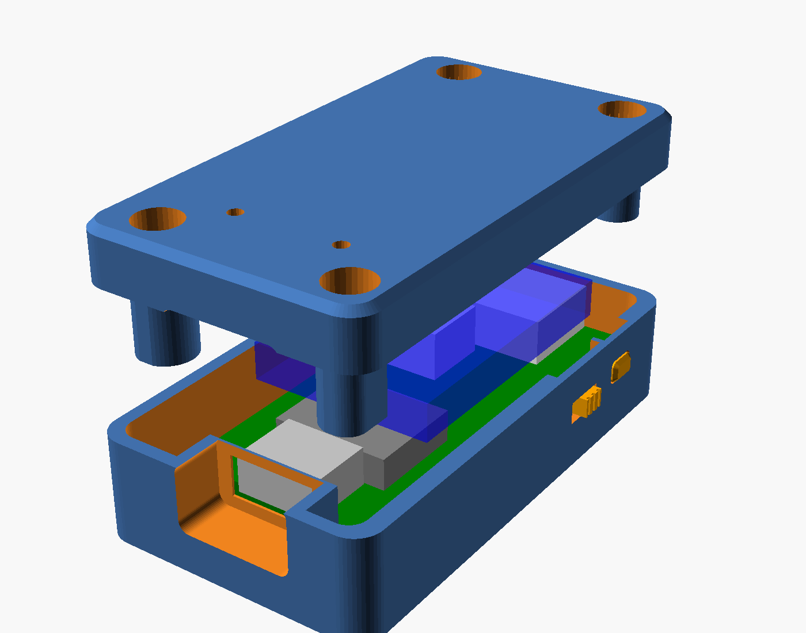

# Media Remote

A pocket-sized Bluetooth remote for your phone's music. It has a colour screen that shows the song, the artist, the album art and a progress bar.

Built on the **Seeed Studio XIAO nRF52840 Plus** with Seeed's **XIAO 1.14″ IPS display board**, in a 3D-printed screw-together case.



## Features
- **Works with any music app.** It appears to the phone as a Bluetooth media remote. It's not a keyboard, so the on-screen keyboard keeps working.
- **Controls:** play/pause, next, previous, seek and volume, with no app needed.
- **With the Android companion app:** the screen shows the title, artist, album art, progress and volume, and holding a button seeks in 10-second jumps.
- **Power saving:** the screen sleeps after 20 s idle, and the remote switches itself off after 10 minutes with no phone connected. A slide switch on the case disconnects the battery completely.
- **Battery:** a 200 mAh LiPo that charges over USB-C, with the charge level shown on screen.

## Controls
Hold the remote with the screen facing you.

| Button | Tap | Hold |
|---|---|---|
| **Left** | Previous track | Rewind |
| **Right** | Next track | Fast-forward |
| **Side** | Play / pause | 0.6 s: volume mode (Left = quieter, Right = louder) · 3 s: power off |

- Press **Side** to turn it back on.
- Hold **Left + Right** while the remote resets to forget all paired phones.

### Treadmill mode (experimental, not yet tested on hardware)
The remote can also pose as a Bluetooth foot pod for a running watch: you set the treadmill's belt speed on the remote and the watch uses it for pace and distance. Hold **Side** for 1.5 s to switch between the music screen and the treadmill screen. See [`docs/treadmill-mode.md`](docs/treadmill-mode.md).

`firmware/prebuilt/MediaRemote.uf2` is still the released firmware without treadmill mode.

## What you need
| Part | Notes |
|---|---|
| Seeed Studio XIAO 1.14″ IPS Display board **with XIAO nRF52840 Plus** | The nRF52840 version, not the ESP32-S3 one |
| 402030 LiPo, 3.7 V 200 mAh, **JST PH 2.0 mm 2-pin plug** | ⚠️ JST plugs aren't standardised: check the red wire lines up with **+** on the board before plugging in |
| 4 × M2.5 × 12 mm socket head cap screws | 10 mm screws are too short |
| 4 × M2.5 heat-set inserts, **3 mm long** | Fit into 3.6 mm holes |
| 3D-printed case parts | See [`enclosure/`](enclosure/) |
| Kapton or electrical tape | A strip over the XIAO's metal shield, under the battery |

## Getting started
Ready-made downloads for both the firmware and the app are on the **[Releases page](https://github.com/MatseroAE/media-remote/releases/latest)**. They're rebuilt automatically whenever the code changes.

1. **Flash the firmware.** Download `MediaRemote.uf2` from [Releases](https://github.com/MatseroAE/media-remote/releases/latest), connect the board over USB-C, and double-tap its reset button. A USB drive appears; drag the `.uf2` onto it. The board restarts with the new firmware.
   To build the firmware yourself, see [`firmware/BUILDING.md`](firmware/BUILDING.md).
2. **Pair it.** On your phone, open Bluetooth settings and pair **Media Remote**. The buttons work straight away.
3. **Optional: install the companion app.** On your phone, open the [Releases page](https://github.com/MatseroAE/media-remote/releases/latest), tap **MediaRemote.apk** and install it. Android will ask you to allow installs from your browser.
   To build it yourself instead, open [`android/MediaRemoteCompanion`](android/MediaRemoteCompanion) in Android Studio and press **Run**. In the app:
   1. Allow Bluetooth.
   2. Turn on **Notification access**. The app uses it to read what's playing; it never reads or stores your notifications.
   3. Choose the remote.

   The dot on the remote's screen turns green once it's linked.
4. **Print and assemble the case.** See [`enclosure/README.md`](enclosure/README.md).

## Troubleshooting
- **Won't charge / shows "No batt" on USB:** the power slide switch sits between the battery and the charger, so it must be **on** to charge. While it's charging, a bolt icon shows next to the battery level.
- **No song info on the remote:** open the app and check the **"Sending to remote"** line. If it says the media listener isn't running, switch Notification access off and on again. On Samsung phones, also add the app to **Never sleeping apps**.
- **No album art, or the app says a service is missing:** after a firmware update that adds features, forget the remote in the phone's Bluetooth settings and pair it again.
- **The app won't install over an older copy** (a "package conflicts" message): the old copy was signed with a different key. Uninstall it, install the new one, and redo the three setup steps. After that, updates install over the top.
- **A button misbehaves:** flash [`firmware/ButtonTest`](firmware/ButtonTest) and open Serial Monitor at 115200 baud. It shows each button's state live.
- **No COM port or USB drive appears:** the remote may be powered off (press Side), or the cable may be charge-only. Double-tap reset to force the bootloader.

## Repository layout
```
firmware/
  MediaRemote/          Arduino sketch for the remote
  ButtonTest/           Small sketch for checking the buttons
  prebuilt/             Ready-to-flash MediaRemote.uf2
  BUILDING.md           Arduino IDE / arduino-cli build notes
android/
  MediaRemoteCompanion/ Android Studio project (Kotlin, no extra libraries)
enclosure/
  stl/                  Print files
  MediaRemote_case_v3.scad   Editable OpenSCAD source (battery size, fit settings)
  README.md             Print settings, hardware and assembly
```

## Licence
- Code (firmware and app): **MIT**.
- Enclosure: **CC BY-NC-SA 4.0**.

See [`LICENSE`](LICENSE).

This project isn't affiliated with Seeed Studio. The board dimensions were taken from Seeed's published design files; none of those files are included here.

The firmware, app and enclosure were developed with the help of an AI assistant (Claude), then built and tested on real hardware.
